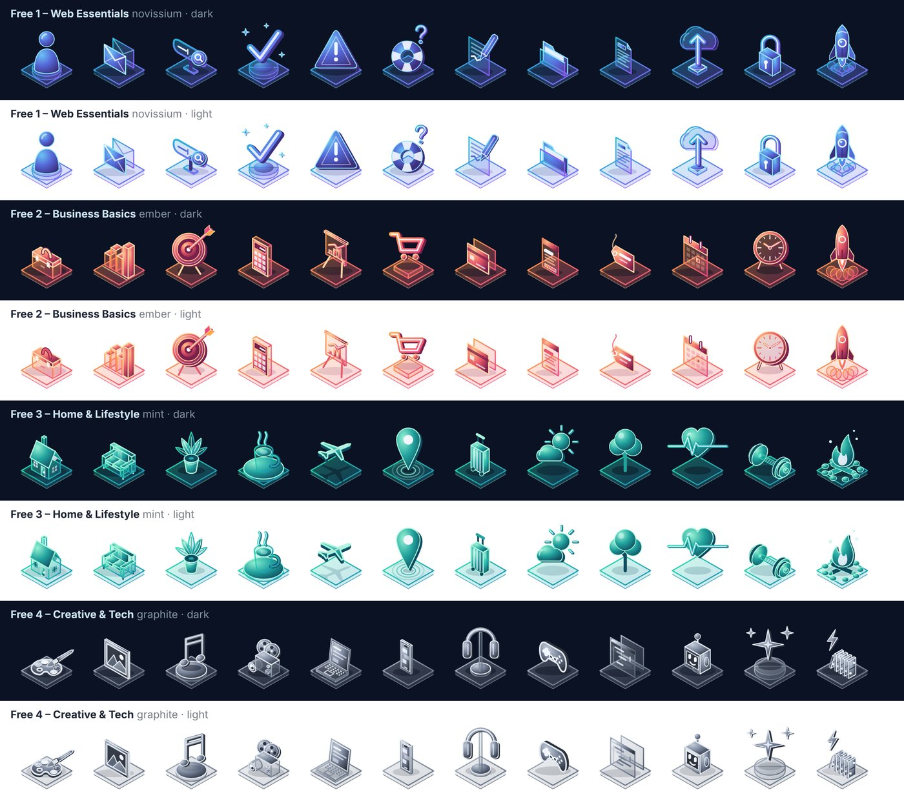

# NoviGlow Free

48 free isometric glass icons by [Novissium](https://novissium.com).

Every icon is a small 3D scene on a glass plate: gradients, translucent glass and soft light, in four colour themes. Each icon comes in a **dark** and a **light** version.



## What's inside

| Set | Theme | Icons |
|---|---|---|
| Web Essentials | Novissium (cyan → violet) | user, mail, search-bar, success, warning, help, edit, folder, document, cloud-upload, lock, deploy |
| Business Basics | Ember (orange → pink) | briefcase, bar-chart, target, calculator, presentation, cart, credit-card, pricing-card, price-tag, calendar, clock, launch |
| Home & Lifestyle | Mint (mint → teal) | house, sofa, house-plant, coffee-break, airplane, map-pin, suitcase, partly-cloudy, tree, heart-pulse, dumbbell, campfire |
| Creative & Tech | Graphite (silver → slate) | palette, image, music, video-camera, laptop, smartphone, headphones, gamepad, code-editor, bot, sparkles, workflow-event-trigger |

```
svg/dark/   icons for dark backgrounds
svg/light/  icons for light backgrounds
```

All icons use a `0 0 160 160` viewBox and look best at **48 px and larger**. They work as plain SVG files in any website, app or design tool, and can be uploaded as SVG icons in page builders such as Elementor.

## Want more?

NoviGlow has more than 900 icons in 26 themed packs, every icon in all four colour themes, dark and light, as SVG and PNG. See [novissium.com](https://novissium.com).

## License

The icons in this repository are licensed under [Creative Commons Attribution 4.0 International (CC BY 4.0)](https://creativecommons.org/licenses/by/4.0/).

You may use, share and adapt them, also commercially, as long as you give credit:

> Icons: NoviGlow by Novissium – https://novissium.com
